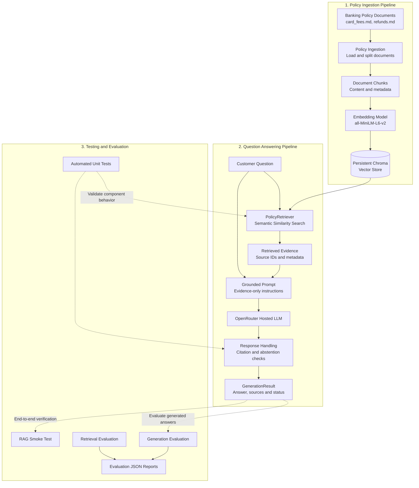

# Banking Support AI Platform

## Overview

A production-oriented Generative AI application designed to answer banking customer-support questions using retrieval-augmented generation (RAG), policy-grounded responses, source citations, and controlled abstention.

The platform retrieves relevant information from banking policy documents and uses a hosted large language model to generate answers grounded in that evidence. When the available evidence is insufficient, the system is designed to abstain rather than invent policy details or make unsupported promises.

This project focuses on the engineering practices required to move a GenAI application toward production, including modular architecture, automated testing, retrieval evaluation, answer evaluation, observability, API development, and deployment.

## Objectives

- Build a modular Retrieval-Augmented Generation (RAG) pipeline.
- Integrate hosted language models through LangChain and OpenRouter.
- Ingest, chunk, embed, and retrieve banking policy documents.
- Use a persistent vector store for semantic search.
- Generate evidence-grounded answers with source citations.
- Implement abstention behavior for unsupported questions.
- Evaluate retrieval quality and answer-generation behavior.
- Introduce LangGraph for stateful workflow orchestration.
- Expose the application through FastAPI.
- Add automated testing, tracing, observability, containerization, and deployment practices.

## Current Status

### Implemented

- [x] Project environment and dependencies configured.
- [x] Hosted LLM integration with OpenRouter.
- [x] Banking policy document ingestion and chunking.
- [x] Persistent Chroma vector store.
- [x] Semantic retrieval using `sentence-transformers/all-MiniLM-L6-v2`.
- [x] Grounded answer generation using retrieved policy evidence.
- [x] Source citation handling and basic citation validation.
- [x] Abstention behavior for unsupported or insufficiently supported questions.
- [x] Unit tests for the generation component.
- [x] Retrieval evaluation dataset and evaluation workflow.
- [x] Generation evaluation dataset and report generation.
- [x] End-to-end RAG smoke test.

### Planned

- [ ] Improve generation evaluation and claim-level citation verification.
- [ ] Investigate intermittent empty responses from the hosted LLM.
- [ ] Implement LangGraph workflow orchestration.
- [ ] Add conversation state and multi-turn support.
- [ ] Expose functionality through FastAPI.
- [ ] Add LLM tracing and production-oriented observability.
- [ ] Expand evaluation and regression testing.
- [ ] Containerize the application with Docker.
- [ ] Add CI checks and automated testing through GitHub Actions.
- [ ] Prepare cloud deployment and operational monitoring.

_Note: Evaluation infrastructure exists, but its checks and results still require refinement. Passing unit tests does not by itself establish production readiness._

## Architecture

The current system has two primary paths: policy ingestion and question answering.



### Current Request Lifecycle

1. Policy documents are loaded and split into manageable chunks.
2. Chunks are embedded and stored in Chroma.
3. A customer question is passed to the retriever.
4. Relevant policy passages are retrieved using semantic similarity.
5. The passages are included in a constrained prompt for the hosted LLM.
6. The generated response is checked for basic citation and abstention requirements.
7. A structured result is returned with the answer, sources, retrieval metadata, and abstention status.

### Planned Architecture Extensions

LangGraph will introduce explicit workflow state and orchestration. FastAPI will expose the application to external clients. Tracing, expanded evaluation, Docker, CI/CD, and cloud deployment will build on that foundation.

These components are planned extensions, not yet implemented features.

## Technology Stack

| Component           | Technology                         | Purpose                                 |
| ------------------- | ---------------------------------- | --------------------------------------- |
| Language            | Python                             | Application implementation              |
| LLM integration     | LangChain                          | Model and prompt integration            |
| Hosted model access | OpenRouter                         | LLM inference                           |
| Embeddings          | Hugging Face Sentence Transformers | Semantic representations                |
| Vector store        | Chroma                             | Persistent vector storage and retrieval |
| Evaluation          | Python, JSON, pytest               | Test cases and evaluation reports       |
| Orchestration       | LangGraph — planned                | Stateful workflow execution             |
| API                 | FastAPI — planned                  | HTTP interface                          |
| Observability       | GenAI tracing tools — planned      | Trace and inspect LLM workflows         |
| Containerization    | Docker — planned                   | Reproducible deployment                 |
| CI/CD               | GitHub Actions — planned           | Automated checks and delivery           |

## Project Structure

The structure below describes the main components and intended locations. Confirm the actual repository tree before treating every listed directory as present.

```text
Banking-Support-AI/
├── configs/                  # Application configuration
├── data/
│   └── vector_store/
│       └── chroma/           # Local persistent vector store
├── evals/
│   ├── retrieval_eval.json
│   └── generation_eval.json
├── knowledge_base/
│   └── policies/
│       ├── card_fees.md
│       └── refunds.md
├── reports/                  # Generated evaluation reports
├── scripts/
│   └── smoke_test_rag.py
├── src/
│   ├── ingestion.py           # Policy ingestion and chunking
│   ├── retrieval.py           # Chroma indexing and retrieval
│   ├── generation.py          # Grounded answer generation
│   └── evaluation/
│       └── generation_evaluator.py
├── tests/
│   └── test_generation.py
├── .env                      # Local secrets; never commit
├── .gitignore
├── requirements.txt
└── README.md
```

## Getting Started

### Prerequisites

- Python compatible with the project's configured environment.
- A Conda environment or Python virtual environment.
- An OpenRouter API key for live LLM calls.
- Internet access for hosted inference and any required model downloads.

### Installation

Clone the repository and enter the project directory:

```bash
git clone <your-repository-url>
cd Banking-Support-AI
```

Activate your configured environment, then install the project dependencies:

```bash
pip install -r requirements.txt
```

Create a local `.env` file in the project root and configure the required environment variables:

```text
OPENROUTER_API_KEY=your_api_key
OPENROUTER_MODEL=your_configured_model
```

Use your actual configured model identifier. Never commit `.env` or expose API keys in logs, screenshots, source code, or Git history.

### Run the RAG Smoke Test

From the project root:

```bash
python scripts/smoke_test_rag.py "What should I do if my card is charged twice?"
```

The smoke test exercises the current ingestion, retrieval, and grounded answer-generation path.

### Run Unit Tests

```bash
pytest
```

The generation unit-test suite previously passed all 24 tests. Run the complete suite again before committing to confirm the current repository state.

### Run Generation Evaluation

```bash
python -m src.evaluation.generation_evaluator
```

The evaluator uses the generation dataset and writes a JSON report to the configured report path. Evaluation currently needs further refinement, particularly around paraphrased facts, abstention expectations, and intermittent empty model responses.

## Grounding and Safety

The application is designed to:

- Use retrieved policy evidence to ground its answers.
- Avoid inventing banking policy or promising unconfirmed refunds.
- Include source identifiers for supported claims.
- Abstain when the available evidence cannot sufficiently answer a question.
- Keep API credentials outside source control.
- Use synthetic questions and local policy documents during initial development.

Citation-ID validation confirms that a citation refers to a retrieved source; it does not independently prove that the source supports the associated claim. Claim-level verification remains future work.

This is a software engineering project, not a production banking service. Its outputs must not be treated as authoritative financial advice or as confirmation of an individual customer's account status or refund eligibility.

## Evaluation Strategy

The project separates retrieval evaluation from generation evaluation.

**Retrieval evaluation** examines whether the retriever returns relevant policy passages for test questions.

**Generation evaluation** examines expected answer facts, source coverage, abstention behavior, and citation validity.

Evaluation datasets and reports are intended to support regression testing as the policy corpus, prompts, retrieval settings, and models evolve. Metrics will be refined before being used as evidence of production readiness.

## Roadmap

1. Complete the current RAG foundation and document the implementation.
2. Refine evaluation checks and investigate model-response edge cases.
3. Implement LangGraph orchestration and conversation state.
4. Build and test the FastAPI service.
5. Add tracing, monitoring, and stronger groundedness evaluations.
6. Containerize the service and implement CI checks.
7. Prepare deployment, operational monitoring, and production-readiness testing.

## Development Principles

- Modular, testable components.
- Configuration and secrets kept separate from source code.
- Evidence-grounded generation with explicit failure handling.
- Automated tests before integration changes.
- Reproducible evaluation and transparent reporting.
- Clear separation between implemented features and planned work.
